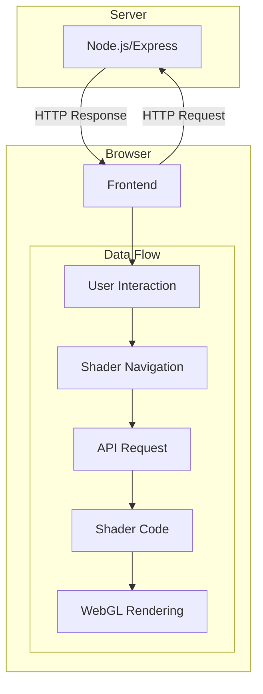

# Architecture Overview: Psycho-Doom-Scroller

---

## 1. Introduction & Vision

### 1.1. Purpose of this Document
This document provides a holistic view of the Psycho-Doom-Scroller application's current architecture, its components, and its strategic direction. It is intended to be a living document that evolves with the system.

### 1.2. Scope
The scope of this document covers the frontend and backend components of the Psycho-Doom-Scroller application, including the WebGL rendering engine, the Node.js/Express backend, and the interaction between them. It does not cover the specifics of the GLSL shader code itself, but rather the system that serves and displays it.

### 1.3. Target Audience
This document is intended for:
*   **New Engineers:** To quickly onboard and understand the system's architecture.
*   **Developers:** To have a shared understanding of the system's design and components.
*   **Product Managers:** To understand the technical implementation of the product.
*   **Technical Stakeholders:** To have a high-level overview of the system.

---

## 2. Architectural Goals & Constraints

### 2.1. Key Drivers (Quality Attributes)
*   **High Performance:** The application must provide a smooth, ~60 FPS experience on both mobile and desktop browsers.
*   **Low Latency:** Shader transitions must be near-instantaneous, which is achieved through preloading.
*   **High Availability:** The application should be highly available, with graceful error handling for shader compilation and network issues.
*   **Maintainability:** The codebase should be easy to understand, modify, and extend.
*   **Evolvability:** The architecture should support future features, such as the planned real-time shader uniform controls.

### 2.2. Technical & Business Constraints
*   **Budget:** The project is currently operating with no budget, which limits the use of paid services.
*   **Team Expertise:** The current team has expertise in Node.js, Express, and WebGL.
*   **Legacy Systems:** There are no legacy systems to integrate with.
*   **Compliance Requirements:** There are no specific compliance requirements for the MVP.
*   **No Database:** The MVP does not include a database; shader management is done manually through the file system.

---

## 3. Current State (As-Is) Architecture

### 3.1. High-Level Diagram Description
The system is composed of a Node.js/Express backend that serves a static frontend application. The frontend is responsible for rendering the shaders in a WebGL context and handling user interactions.

### 3.2. Key Components & Responsibilities
*   **Frontend (Browser):**
    *   **WebGL Canvas:** Renders the current shader fullscreen.
    *   **Navigation Handler:** Listens for scroll, swipe, click, and key events to trigger shader changes.
    *   **Shader Loader:** Fetches shader code from the backend and compiles it in the browser.
    *   **Preloader:** Preloads the next shader in the background for instant switching.
    *   **Loading Indicator:** Shows when a shader is being loaded/compiled.
    *   **Error Handler:** Skips to the next shader if a load/compile error occurs.
*   **Backend (Node.js/Express):**
    *   **Manifest Endpoint (`/api/shaders/manifest`):** Serves a JSON list of available shaders.
    *   **Shader Endpoint (`/api/shaders/:id`):** Serves the GLSL code for a given shader ID.
    *   **Static File Server:** Serves the frontend assets (HTML, CSS, JavaScript).

### 3.3. Technology Stack
*   **Frontend:**
    *   **Language:** JavaScript (ES6+)
    *   **Rendering:** WebGL2
    *   **Shaders:** GLSL
*   **Backend:**
    *   **Runtime:** Node.js
    *   **Framework:** Express
*   **Infrastructure:**
    *   **Deployment:** The application is served locally via a Node.js server.
    *   **CI/CD:** Not yet implemented.

### 3.4. Data Flow & Management
1.  On application load, the frontend fetches the shader manifest from the `/api/shaders/manifest` endpoint.
2.  The frontend then loads and compiles the first shader in the manifest.
3.  When the user interacts with the application (scroll, swipe, click, or key press), the frontend requests the next/previous shader from the `/api/shaders/:id` endpoint.
4.  The next shader is preloaded in the background to ensure a smooth transition.
5.  If a shader fails to load or compile, the error is handled gracefully, and the application skips to the next available shader.

---

## 4. Cross-Cutting Concerns

### 4.1. Authentication & Authorization
*   **Not Applicable:** The application is public and does not have user accounts or protected resources.

### 4.2. Logging & Monitoring
*   **Backend:** The Node.js server logs basic information to the console, such as when the server starts.
*   **Frontend:** The frontend logs shader compilation errors to the browser console.

### 4.3. Security
*   **HTTPS:** Not yet implemented for local development.
*   **Secrets:** There are no secrets to manage in the current architecture.
*   **Vulnerability Scanning:** Not yet implemented.

### 4.4. Communication
*   **Frontend-Backend:** Communication is done via RESTful APIs over HTTP.

---

## 5. Analysis: Strengths, Risks, and Concerns

### 5.1. Strengths
*   **Simplicity:** The current architecture is simple and easy to understand.
*   **Performance:** The use of WebGL and shader preloading provides a high-performance, smooth user experience.
*   **Decoupling:** The frontend and backend are well-decoupled, allowing for independent development and deployment.

### 5.2. Identified Risks & Technical Debt
*   **Manual Shader Management:** The manual process of adding and validating shaders is a potential bottleneck and source of error.
*   **Limited Test Coverage:** The project has limited automated test coverage.
*   **No CI/CD:** The lack of a CI/CD pipeline means that the build, test, and deployment processes are manual.

### 5.3. Scalability & Performance Concerns
*   **Shader Compilation:** Complex shaders may have long compilation times, which could impact the user experience.
*   **Mobile Performance:** While the application is designed to be responsive, performance on low-end mobile devices has not been thoroughly tested.

### 5.4. Maintainability & Evolvability Concerns
*   **Shader Metadata:** The current approach of embedding shader metadata in comments could become difficult to manage as the number of shaders and configurable uniforms grows.
*   **Monolithic Frontend:** The frontend is a single JavaScript file, which could become difficult to maintain as more features are added.

---

## 6. Future Evolution & Proposed Improvements
*   **Real-time Shader Uniform Controls:** The next major feature is to allow users to control shader `uniforms` in real-time via a UI panel. This will transform the application from a passive viewer into an interactive creative tool.
*   **Automated Shader Management:** To address the risks of manual shader management, a future improvement would be to automate the process of adding, validating, and managing shaders.
*   **CI/CD Pipeline:** Implementing a CI/CD pipeline would automate the build, test, and deployment processes, improving reliability and development velocity.
*   **Frontend Modularity:** As the frontend grows, it should be refactored into smaller, more manageable modules to improve maintainability.