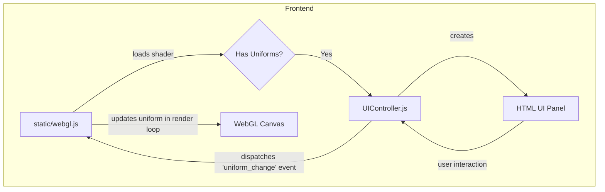

# Design Document: Interactive Shader Uniforms

**Phase:** 2 - The Interactive Evolution
**Feature:** Real-time Shader Uniform Controls

## 1. Overview

This document outlines the technical specification for implementing a dynamic user interface that allows users to control shader `uniforms` in real-time. This feature is the top priority for Phase 2 as it transforms the application from a passive viewer into an interactive creative tool.

## 2. Backend Architecture

### 2.1. Metadata Convention

Shader-specific uniform metadata will be embedded directly within the `.glsl` files using a YAML-formatted comment block at the top of the file. This approach keeps the shader and its configuration tightly coupled.

**Example (`/shaders/some-shader.glsl`):**
```glsl
/*
uniforms:
- name: u_speed
  type: float
  label: "Animation Speed"
  default: 1.0
  min: 0.1
  max: 5.0
  step: 0.1
- name: u_colorTint
  type: "vec3"
  label: "Color Tint"
  default: [1.0, 0.8, 0.5]
- name: u_enableTwist
  type: "bool"
  label: "Enable Twist"
  default: true
*/

// ... rest of the shader code
```

### 2.2. API Enhancement (`server.js`)

The `GET /api/shaders/manifest` endpoint in `server.js` will be enhanced:
1.  When reading each `.glsl` file, it will look for the `/* uniforms: ... */` block.
2.  It will parse the YAML content from this block.
3.  The parsed `uniforms` array will be added to the shader's entry in the manifest JSON.
4.  If no block is found, an empty `uniforms` array will be sent.

## 3. Frontend Architecture

### 3.1. Data Flow

The data flow is designed to be event-driven, decoupling the UI from the WebGL rendering logic.



### 3.2. New Module: `UIController.js`

A new file, `static/UIController.js`, will be created to handle all UI-related logic.

**Responsibilities:**
- **`init(uniforms)`:** Takes the uniforms metadata for the current shader.
- **`renderPanel()`:** Dynamically generates HTML input elements (e.g., `<input type="range">` for floats, `<input type="color">` for vec3, `<input type="checkbox">` for bools) and appends them to a container div.
- **`destroyPanel()`:** Removes the UI panel when a shader with no uniforms is loaded or during transitions.
- **Event Handling:** Listens for `input` events on the generated controls. On change, it will fire a `CustomEvent`.

**Example Custom Event:**
```javascript
const event = new CustomEvent('uniform_change', {
  detail: {
    name: 'u_speed',
    value: 2.5
  }
});
document.dispatchEvent(event);
```

### 3.3. Modifications to `webgl.js`

1.  **State Management:** A new object, `currentUserUniforms`, will be added to store the current values of the interactive uniforms.
2.  **Integration:** After a shader is loaded, `webgl.js` will check `shaderManifest[currentShaderIndex].uniforms`. If uniforms exist, it will call `UIController.init()`.
3.  **Event Listener:** It will listen for the `uniform_change` event on the `document`. When the event is caught, it will update the `currentUserUniforms` object.
4.  **Render Loop:** The `setStandardUniforms` function will be modified to read values from `currentUserUniforms` and pass them to the shader program on each frame.

## 4. Next Steps

1.  Update `server.js` to parse uniform metadata.
2.  Create `static/UIController.js` and implement the panel generation logic.
3.  Modify `static/webgl.js` to integrate with the `UIController` and update the render loop.
4.  Add styles to `static/style.css` for the UI panel.