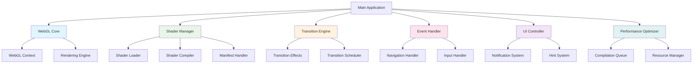
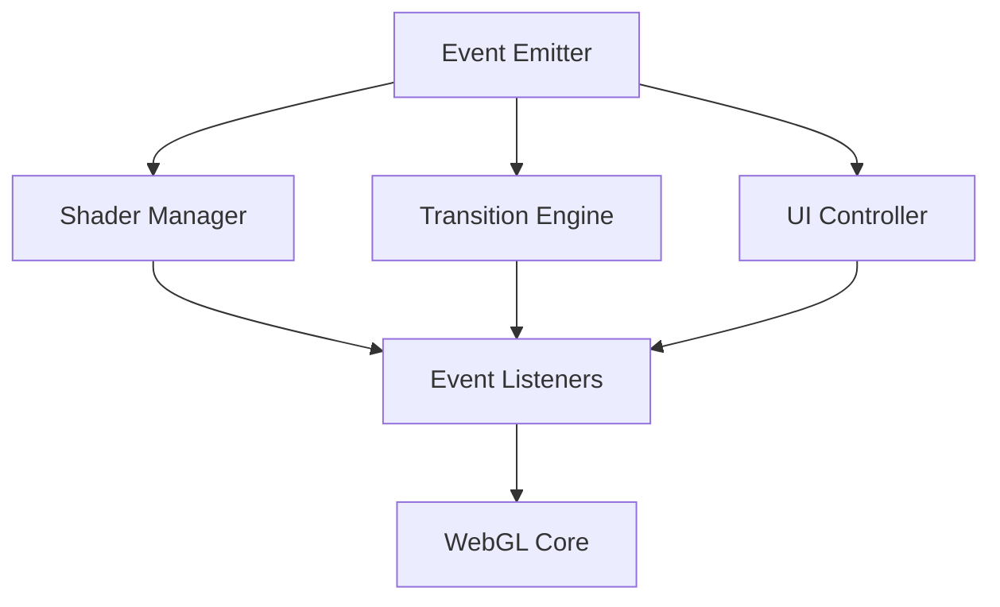

# Design Document: WebGL Implementation Modularization

**Phase:** 3 - Architectural Refinement
**Feature:** Modular WebGL Implementation

## 1. Overview

This document outlines the technical specification for refactoring the monolithic `webgl.js` file into a modular architecture. This refactoring will improve maintainability, testability, and extensibility of the WebGL implementation while preserving all existing functionality.

## 2. Current State Analysis

### 2.1. Issues with Current Implementation

The current `webgl.js` file suffers from several architectural issues:

1. **Monolithic Structure**: Single file with over 1,400 lines mixing multiple concerns
2. **Tight Coupling**: All functionality is tightly coupled within one file
3. **Poor Testability**: Difficult to unit test individual components
4. **Limited Extensibility**: Adding new features requires modifying the core file
5. **Maintenance Overhead**: Changes in one area can affect unrelated functionality

### 2.2. Functional Areas in Current Implementation

The current implementation contains these distinct functional areas:
- WebGL context management
- Shader loading and compilation
- Shader manifest handling
- Transition system
- Event handling (navigation, resize, etc.)
- UI components (notifications, navigation hints)
- Performance optimization (compilation queue)
- State management (global variables)

## 3. Proposed Modular Architecture

### 3.1. Module Structure

We will split the functionality into the following modules with their defined interfaces:



### 3.2. Module Responsibilities

#### 3.2.1. WebGL Core (`webgl-core.js`)
**Responsibilities:**
- Initialize and manage WebGL context
- Handle basic WebGL operations (clear, viewport, etc.)
- Manage current shader program
- Provide interface for rendering operations

**Scope:**
- WebGL context creation and management
- Basic rendering operations
- Program management
- Error handling for WebGL operations

**Interface:**
```javascript
class WebGLCore {
  constructor(options = {}) {
    this.canvas = null;
    this.gl = null;
    this.currentProgram = null;
    this.options = options;
  }
  
  // Public methods
  init(canvas) { }
  destroy() { }
  clear() { }
  render(time) { }
  useProgram(program) { }
  setViewport(width, height) { }
  getUniformLocation(name) { }
  setUniform(location, value, type) { }
  
  // Getters/Setters
  getContext() { }
  getCanvas() { }
  getCurrentProgram() { }
  
  // Event handlers
  handleResize(event) { }
}
```

**Internal Methods:**
- `_createContext(canvas)` - Initialize WebGL context
- `_handleContextLost(event)` - Handle WebGL context loss
- `_handleContextRestored(event)` - Handle WebGL context restoration
- `_setupDebugging()` - Set up WebGL debugging utilities
- `_validateContext()` - Validate WebGL context capabilities

**Properties:**
- `canvas` - The canvas element
- `gl` - The WebGL context
- `currentProgram` - Currently active shader program
- `options` - Configuration options
- `debugMode` - Debug mode flag

#### 3.2.2. Shader Manager (`shader-manager.js`)
**Responsibilities:**
- Load shaders from various sources
- Compile and link shader programs
- Manage shader manifest
- Handle shader caching

**Scope:**
- Shader loading from network or cache
- Shader compilation and linking
- Manifest parsing and management
- Shader source caching

**Interface:**
```javascript
class ShaderManager {
  constructor(webglCore, options = {}) {
    this.webglCore = webglCore;
    this.manifest = [];
    this.cache = {};
    this.options = options;
  }
  
  // Public methods
  init() { }
  destroy() { }
  loadManifest() { }
  loadShaderById(id) { }
  compileShaderProgram(vertexSource, fragmentSource, shaderId) { }
  getShaderProgram(id) { }
  preloadShaders(count) { }
  
  // Getters/Setters
  getManifest() { }
  getCache() { }
  getCurrentShader() { }
  
  // Event handlers
  handleShaderLoad(event) { }
  handleCompilationError(event) { }
}
```

**Internal Methods:**
- `_fetchShaderManifest()` - Fetch shader manifest from API
- `_fetchShaderSource(id)` - Fetch individual shader source
- `_createShader(gl, source, type)` - Create WebGL shader
- `_createProgram(gl, vertexShader, fragmentShader)` - Create WebGL program
- `_setupVertexBuffer(program)` - Set up vertex buffer for shader
- `_updateUniformLocations(program)` - Update uniform locations for shader
- `_shuffleArray(array)` - Shuffle array for random navigation

**Properties:**
- `webglCore` - Reference to WebGL core module
- `manifest` - Shader manifest array
- `cache` - Shader source cache
- `currentShader` - Currently active shader
- `compilationQueue` - Queue for shader compilation
- `options` - Configuration options

#### 3.2.3. Transition Engine (`transition-engine.js`)
**Responsibilities:**
- Manage shader transitions
- Implement various transition effects
- Handle transition timing and progress
- Coordinate between shader programs during transitions

**Scope:**
- Transition effect implementations
- Transition timing calculations
- Shader program coordination during transitions
- Transition state management

**Interface:**
```javascript
class TransitionEngine {
  constructor(webglCore, shaderManager, options = {}) {
    this.webglCore = webglCore;
    this.shaderManager = shaderManager;
    this.options = options;
  }
  
  // Public methods
  init() { }
  destroy() { }
  startTransition(targetShaderId, direction) { }
  completeTransition(force) { }
  updateTransition(time) { }
  isTransitioning() { }
  
  // Getters/Setters
  getTransitionProgress() { }
  getTransitionDirection() { }
  getPreviousProgram() { }
  getNextProgram() { }
  
  // Event handlers
  handleTransitionStart(event) { }
  handleTransitionComplete(event) { }
}
```

**Internal Methods:**
- `_setupTransitionShaders(targetShaderId)` - Set up shaders for transition
- `_calculateTransitionProgress(elapsedTime)` - Calculate transition progress with easing
- `_renderFadeTransition(time)` - Render fade transition effect
- `_renderSlideTransition(time)` - Render slide transition effect
- `_applyEasingFunction(rawProgress)` - Apply easing function to transition
- `_setupBlendMode(mode)` - Set up blending mode for transition
- `_cleanupTransition()` - Clean up transition resources

**Properties:**
- `webglCore` - Reference to WebGL core module
- `shaderManager` - Reference to Shader manager module
- `active` - Whether transition is active
- `startTime` - Transition start time
- `duration` - Transition duration
- `progress` - Transition progress (0.0 to 1.0)
- `direction` - Transition direction (1 for next, -1 for previous)
- `previousProgram` - Previous shader program
- `nextProgram` - Next shader program
- `options` - Configuration options

#### 3.2.4. Event Handler (`event-handler.js`)
**Responsibilities:**
- Handle user input events (mouse, touch, keyboard)
- Handle system events (resize, orientation change)
- Coordinate event-driven actions
- Implement event throttling and debouncing

**Scope:**
- Input event handling
- System event handling
- Event coordination
- Platform-specific event handling

**Interface:**
```javascript
class EventHandler {
  constructor(webglCore, shaderManager, transitionEngine, options = {}) {
    this.webglCore = webglCore;
    this.shaderManager = shaderManager;
    this.transitionEngine = transitionEngine;
    this.options = options;
  }
  
  // Public methods
  init() { }
  destroy() { }
  setupNavigationHandlers() { }
  setupResizeHandler() { }
  throttleNavigation() { }
  
  // Getters/Setters
  isMobileDevice() { }
  getNavigationCooldown() { }
  
  // Event handlers
  handleWheelEvent(event) { }
  handleTouchStartEvent(event) { }
  handleTouchMoveEvent(event) { }
  handleTouchEndEvent(event) { }
  handleKeyDownEvent(event) { }
  handleResizeEvent(event) { }
  handleClickEvent(event) { }
}
```

**Internal Methods:**
- `_isMobileDevice()` - Detect if device is mobile
- `_preventDefaultBehavior(event)` - Prevent default browser behavior
- `_handleNavigation(direction)` - Handle navigation in specific direction
- `_toggleFullscreen()` - Toggle fullscreen mode
- `_setupEventListeners()` - Set up all event listeners
- `_removeEventListeners()` - Remove all event listeners
- `_handleDoubleTap(event)` - Handle double tap gesture

**Properties:**
- `webglCore` - Reference to WebGL core module
- `shaderManager` - Reference to Shader manager module
- `transitionEngine` - Reference to Transition engine module
- `touchStartY` - Touch start Y coordinate
- `touchStartX` - Touch start X coordinate
- `lastNavigationTime` - Last navigation timestamp
- `navigationCooldown` - Navigation cooldown period
- `isMobile` - Mobile device flag
- `options` - Configuration options

#### 3.2.5. UI Controller (`ui-controller.js`)
**Responsibilities:**
- Manage notification system
- Handle navigation hints
- Manage loading indicators
- Coordinate UI updates

**Scope:**
- User interface components
- Notification display and management
- Hint system implementation
- Loading state visualization

**Interface:**
```javascript
class UIController {
  constructor(webglCore, options = {}) {
    this.webglCore = webglCore;
    this.options = options;
  }
  
  // Public methods
  init() { }
  destroy() { }
  showNotification(message, type, duration) { }
  showNavigationHints() { }
  showLoading(show) { }
  hideNotification() { }
  
  // Getters/Setters
  isEnabled() { }
  getNotificationElement() { }
  
  // Event handlers
  handleNotificationShow(event) { }
  handleNotificationHide(event) { }
}
```

**Internal Methods:**
- `_createNotificationElement(message, type)` - Create notification DOM element
- `_createNavigationHintElement(position, text)` - Create navigation hint element
- `_applyNotificationStyles(notification)` - Apply styles to notification
- `_setupNotificationEvents(notification)` - Set up notification events
- `_removeNotification(notification)` - Remove notification from DOM
- `_setupNavigationHintEvents(hint)` - Set up navigation hint events
- `_removeNavigationHints()` - Remove all navigation hints

**Properties:**
- `webglCore` - Reference to WebGL core module
- `notificationsEnabled` - Whether notifications are enabled
- `isFirstVisit` - Whether this is the first visit
- `notificationElement` - Current notification element
- `navigationHints` - Navigation hint elements
- `options` - Configuration options

#### 3.2.6. Performance Optimizer (`performance-optimizer.js`)
**Responsibilities:**
- Manage shader compilation queue
- Implement resource management
- Handle performance tuning
- Monitor and optimize rendering performance

**Scope:**
- Compilation queue management
- Resource caching and cleanup
- Performance monitoring
- Battery optimization coordination

**Interface:**
```javascript
class PerformanceOptimizer {
  constructor(webglCore, shaderManager, options = {}) {
    this.webglCore = webglCore;
    this.shaderManager = shaderManager;
    this.options = options;
  }
  
  // Public methods
  init() { }
  destroy() { }
  queueShadersForCompilation(startIndex, count) { }
  processShaderQueue() { }
  preloadShaders(count, isInitialLoad) { }
  optimizeForBattery() { }
  
  // Getters/Setters
  getQueueLength() { }
  isProcessingQueue() { }
  getPreloadCount() { }
  
  // Event handlers
  handleQueueProcess(event) { }
  handleBatteryLevelChange(event) { }
}
```

**Internal Methods:**
- `_processNextShaderInQueue()` - Process next shader in compilation queue
- `_compileShader(index)` - Compile shader at specific index
- `_setupBatteryMonitoring()` - Set up battery level monitoring
- `_applyBatteryOptimizations(level, charging)` - Apply optimizations based on battery
- `_calculateOptimalPreloadCount()` - Calculate optimal preload count
- `_setupInactivityTimer()` - Set up inactivity timer
- `_resetInactivityTimer()` - Reset inactivity timer

**Properties:**
- `webglCore` - Reference to WebGL core module
- `shaderManager` - Reference to Shader manager module
- `compilationQueue` - Shader compilation queue
- `isProcessing` - Whether queue is being processed
- `preloadCount` - Number of shaders to preload
- `inactivityTimer` - Inactivity timer reference
- `batteryMonitoring` - Battery monitoring status
- `options` - Configuration options

### 3.3. Module Interfaces

Each module will expose a well-defined interface with public methods, internal methods, and properties as detailed in sections 3.2.1 through 3.2.6. The general pattern for module interfaces is:

```javascript
class ModuleName {
  constructor(dependencies, options) {
    // Initialize with dependencies and options
    this.dependencies = dependencies;
    this.options = options;
  }
  
  // Public methods
  init() { }
  destroy() { }
  
  // Event handlers
  handleEvent(event) { }
  
  // Getters/Setters for state
  getState() { }
  setState(state) { }
}
```

Each module's specific interface is detailed in its respective section above, including:
- Detailed method signatures
- Internal helper methods
- Properties and their purposes

### 3.4. Dependency Management

Modules will use dependency injection for loose coupling:

```javascript
// Main application coordinates modules
const webglCore = new WebGLCore();
const shaderManager = new ShaderManager({ webglCore });
const transitionEngine = new TransitionEngine({ webglCore, shaderManager });
// ... other modules

// Coordinate initialization
webglCore.init();
shaderManager.init();
// ... initialize other modules
```

## 4. Data Flow Architecture

### 4.1. Event-Driven Communication

Modules will communicate through a publish-subscribe pattern. A central event emitter will be used to decouple modules. For example, if a shader fails to compile, the `ShaderManager` will emit a `SHADER_COMPILE_ERROR` event. The `UIController` will listen for this event and display a notification. This approach avoids direct dependencies between modules.



### 4.2. State Management

A centralized state management approach will be implemented. A single `appState` object will hold the application state. However, modules will not mutate this state directly. Instead, they will emit events that a central state manager (or reducer) will use to update the state. This ensures predictable state changes and makes debugging easier.

```javascript
// Global state object
const appState = {
  webgl: {
    context: null,
    program: null,
    canvas: null
  },
  shaders: {
    manifest: [],
    current: null,
    cache: {}
  },
  transitions: {
    active: false,
    progress: 0,
    direction: 1
  },
  ui: {
    loading: false,
    notifications: []
  }
};
```

## 5. Implementation Plan

### 5.1. Phase 1: Core Module Extraction
1. Extract WebGL context management to `webgl-core.js`
2. Extract shader loading to `shader-manager.js`
3. Extract transition logic to `transition-engine.js`

### 5.2. Phase 2: Peripheral Module Extraction
1. Extract event handling to `event-handler.js`
2. Extract UI components to `ui-controller.js`
3. Extract performance optimization to `performance-optimizer.js`

### 5.3. Phase 3: Integration and Testing
1. Integrate modules with dependency injection
2. Implement event-driven communication
3. Add comprehensive unit tests
4. Verify all existing functionality

## 6. Backward Compatibility

All existing functionality will be preserved:
- Shader loading and display
- Navigation controls
- Transitions
- Performance optimizations
- Error handling

API changes will be minimal and backward-compatible where possible.

## 7. Testing Strategy

### 7.1. Unit Tests
Each module will have dedicated unit tests covering:
- Public method functionality
- Error conditions
- Edge cases
- State management

We will use a mock WebGL context for testing `WebGLCore` to verify that it makes the correct WebGL calls without needing a full browser environment.

### 7.2. Integration Tests
Integration tests will verify:
- Module communication
- Event handling
- State consistency
- Performance characteristics

## 8. Performance Considerations

The modular approach should maintain or improve performance:
- Reduced memory footprint through better resource management
- Improved initialization time through parallel module loading
- Better caching strategies
- More efficient error handling

We will add performance profiling hooks (e.g., `performance.now()`) to key operations in `WebGLCore` and `TransitionEngine` to monitor performance during development.

## 9. Security Considerations

- Input validation will be maintained in shader loading
- Path traversal protection will be preserved
- WebGL security restrictions will be maintained

## 10. Rollout Strategy

### 10.1. Development
1. Create new module files alongside existing `webgl.js`
2. Implement modules incrementally
3. Add tests for each module
4. Verify functionality with existing tests

### 10.2. Deployment
1. Deploy with both old and new implementations
2. Feature flag to enable modular implementation
3. Monitor performance and error rates
4. Gradually phase out old implementation

We will use an adapter/facade pattern to bridge the new modules with the old `webgl.js` file during the transition. This will allow us to migrate features incrementally.

## 11. Risks and Mitigations

### 11.1. Risks
- Breaking existing functionality
- Performance degradation
- Increased complexity during transition period
- WebGL state leakage between modules

### 11.2. Mitigations
- Comprehensive testing
- Feature flags for gradual rollout
- Detailed monitoring and alerting
- Rollback plan
- A `WebGLStateTracker` will be implemented in `WebGLCore` to log state changes and warn about potential conflicts during development.

## 12. Success Metrics

- Reduced file size of main WebGL implementation
- Improved test coverage (>80%)
- Maintained or improved performance
- Reduced bug reports related to WebGL functionality
- Faster development cycle for new features

## 13. Future Extensibility

The modular architecture is designed to support future features such as:
- **Post-processing effects:** Can be implemented as new modules that plug into the render pipeline.
- **Multiple render passes:** Can be managed by a `RenderPassManager` module.
- **Scene graph:** Can be a separate `SceneGraph` module that interacts with `WebGLCore`.
- **Material system:** A `Material` or `UniformBuffer` abstraction can be created to encapsulate shader programs and their uniforms, making it easier to manage shaders with different requirements.